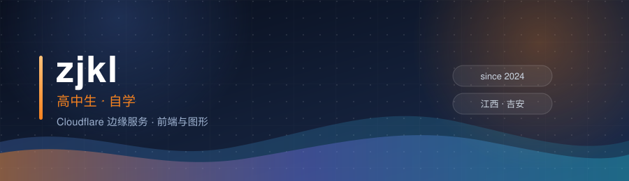
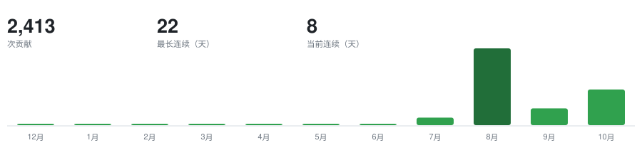

 

**高中生，自学。跑在 Cloudflare 边缘的一堆服务，和几个自己啃下来的前端 / 图形项目。**

标注约定：

| `自研` | `二次开发` | `部署在用` | `已停用` |
| :---: | :---: | :---: | :---: |
| 代码由我写成 | 基于上游项目改造，已注明上游 | 拿上游部署，不声称原创 | 仓库与对应服务不再维护 |

 

<picture>
  <source media="(prefers-color-scheme: dark)" srcset="https://raw.githubusercontent.com/827802685/827802685/main/assets/snake-dark.svg" />
  <source media="(prefers-color-scheme: light)" srcset="https://raw.githubusercontent.com/827802685/827802685/main/assets/snake.svg" />
  
</picture>

 

## 🚀 精选项目

> 按最近提交时间排，下面五个是 2026-10 还在推的。

### 🎭 [Live2D](https://github.com/827802685/Live2D) — 2.28 MB 的 Live2D 芙宁娜

自研 · 手写 WebGL 光栅化 · 最近提交 10-31

把一个 **95.5 MB** 的 Cubism `moc3` 模型压到 **2.28 MB** 放进网页——不引 Cubism Core，不用任何运行时库，光栅化是一段手写的 WebGL。呼吸、眨眼、视线跟随、发丝物理全靠逐帧参数驱动；表情用的是**真实采样出来的顶点帧加部件透明度**，不是缩放抖动。第二个模型刻律德菈（Cyrdra）运行时 1.6 MB，4096 贴图 / 26 层 / 28 drawable / 20 参数，配独立设置面板。页面按「本站 → Cloudflare CDN → GitHub Pages → jsDelivr」四级回退加载，boot 界面实时显示下载百分比。最近一轮全在做性能：关 MSAA、用掩码 scissor 裁剪替代全屏 stencil 清屏、相邻 run 合并、自适应档位扩到 6 档。

### 🛰 [cloudflare](https://github.com/827802685/cloudflare) — Cloudflare 第三方控制台 + 安卓 APK

自研 · Vue 3 SPA · 最新 v0.2.15（10-27）

一个 Vue 3 单页应用，能打包成安卓 APK。**APK 是纯直连模式——粘一把 Cloudflare API Token 就能用，不需要部署任何服务**；网页版因为官方 API 无 CORS，要先放一个 Worker 网关。覆盖看板（流量 / 状态码 / 国家分布 / 环比）、Workers 版本与用量、域名与 DNS 增删改、D1 / KV / R2、Zero Trust、多账号切换。所有 API 路径白名单写死并逐字段校验，不做通用透传；错误按 63 次实测的错误码归并成人类可读提示。令牌在本机用随机密钥做 AES-256-GCM 加密。

### ☁️ [clist](https://github.com/827802685/clist-cf) — 网盘 / 图床 / 存储聚合

二次开发，以 CloudPaste 为核心 · 最近提交 10-30（Iter 20）

一个 Worker 同时提供三种服务：多网盘聚合（S3 / WebDAV / OneDrive / Google Drive / Telegram / 阿里云盘 / 百度网盘等）、图床、存储统计与审计日志，跑在 D1 + KV 上、不依赖 R2。迭代到 Iter 20，最近补的是 WebDAV COPY/MOVE 的目标路径作用域校验、图床 IP 相关修复。开发在私有仓 `clist-cf`，公开镜像 [cloud-drive](https://github.com/827802685/cloud-drive) 与之同源（`package.json` 一致，仅部署参数不同）。

### 🌸 [Rin](https://github.com/827802685/Rin) — 博客引擎改造

fork 自 openRin/Rin · 自己提交 20 次 · 最近提交 10-31 · 线上 [blog.zjkl.qzz.io](https://blog.zjkl.qzz.io)

在 Rin 的 Workers + D1 + R2 骨架上改界面与交互。最近两个迭代重做了看板娘：工具栏收起成一颗玻璃球、展开为竖排玻璃面板，还修掉了触发球展开时被面板阴影染黑的问题；同时加了模型预缓存、保活、表情面板、聊天人设与缓存管理。

### 🎵 [meting-api-serverless](https://github.com/827802685/meting-api-serverless) — 多平台音乐 API

二次开发 · Hono · Workers / Vercel 双端 · 最近提交 10-31

基于 `@meting/core` 把网易云、QQ 音乐、酷狗、百度、酷我封装成一套统一接口。我主要动的是 **QQ 音乐 Cookie 失效后的自动接管**：备用 Cookie 池轮换、企业微信告警、失效时兜底播放，以及上游健康度基线。

 

## 🌐 在跑的服务

> 全部自托管在 Cloudflare。清单以自建探活页 [uptime.zjkl.dpdns.org](https://uptime.zjkl.dpdns.org) 的配置为准。

| 服务 | 地址 | 说明 |
| :--- | :--- | :--- |
| 🏠 **主页** | [zjkl.qzz.io](https://zjkl.qzz.io) | 个人门户 |
| 📝 **博客** | [blog.zjkl.qzz.io](https://blog.zjkl.qzz.io) | Rin 改造 · Workers + D1 + R2 |
| 🔥 **新闻墙** | [news.zjkl.qzz.io](https://news.zjkl.qzz.io) | 自写采集，15 分钟一轮 |
| ☁️ **云盘 / 图床** | [clist.zjkl.dpdns.org](https://clist.zjkl.dpdns.org) | 三合一聚合，实例重建中 |
| 📮 **邮箱** | [mail.zjkl.qzz.io](https://mail.zjkl.qzz.io) | AI 分类、验证码提取、全文搜索 |
| 🎭 **Live2D** | [827802685.github.io/Live2D](https://827802685.github.io/Live2D/) | FurinaMini 与刻律德菈 |
| 🛰 **AI 网关** | [api.zjkl.dpdns.org](https://api.zjkl.dpdns.org) | cloud-api 管理后台 |
| 💬 **Chat** | [chat.zjkl.dpdns.org](https://chat.zjkl.dpdns.org) | NextChat 部署 |
| 📊 **探活 / 状态页** | [uptime](https://uptime.zjkl.dpdns.org) · [status](https://status.zjkl.dpdns.org) | UptimeFlare 双实例 |
| 🔗 **短链** | [zjkl0330.dpdns.org](https://zjkl0330.dpdns.org) | Sink 部署 |

 

## 🛠 技术栈

语言

边缘 · Cloudflare

前端 · 图形 · 工具

 

## 📊 Activity

  

<picture>
  <source media="(prefers-color-scheme: dark)" srcset="https://raw.githubusercontent.com/827802685/827802685/main/assets/langs-dark.svg" />
  <source media="(prefers-color-scheme: light)" srcset="https://raw.githubusercontent.com/827802685/827802685/main/assets/langs.svg" />
  
</picture>

 

<picture>
  <source media="(prefers-color-scheme: dark)" srcset="https://raw.githubusercontent.com/827802685/827802685/main/assets/contrib-dark.svg" />
  <source media="(prefers-color-scheme: light)" srcset="https://raw.githubusercontent.com/827802685/827802685/main/assets/contrib.svg" />
  
</picture>

 

## 🤝 合作

对 **Cloudflare Workers / 前端图形 / 自建服务**感兴趣，开 issue 直接聊。接小的自建工具与脚本需求。不接代写、刷量，以及任何要求编造数据的活。

加入 GitHub：2024-02-08 · 坐标：中国 江西 吉安

**能跑起来的才算数。**

