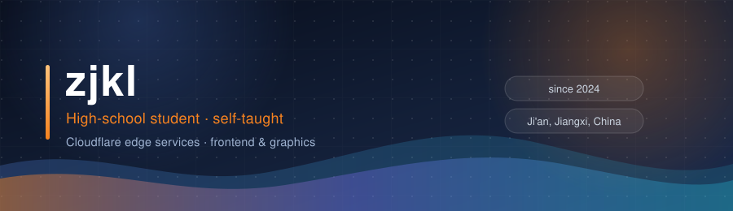
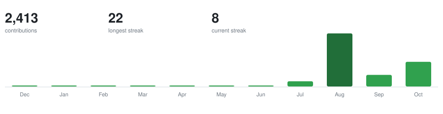

 

**High-school student, self-taught. A pile of services on the Cloudflare edge, plus a few frontend and graphics projects I worked through myself.**

Label conventions:

| `Original` | `Adapted` | `Deployed` | `Archived` |
| :---: | :---: | :---: | :---: |
| I wrote the code | built on an upstream project, which I name | someone else's project that I run, no originality claimed | I no longer maintain the repo or its service |

 

<picture>
  <source media="(prefers-color-scheme: dark)" srcset="https://raw.githubusercontent.com/827802685/827802685/main/assets/snake-dark.svg" />
  <source media="(prefers-color-scheme: light)" srcset="https://raw.githubusercontent.com/827802685/827802685/main/assets/snake.svg" />
  
</picture>

 

## 🚀 Featured projects

> Sorted by last commit. These five are the ones I was pushing on through October 2026.

### 🎭 [Live2D](https://github.com/827802685/Live2D) — a 2.28 MB Live2D Furina

Original · hand-written WebGL rasterizer · last commit 10-31

I squeezed a **95.5 MB** Cubism `moc3` model down to **2.28 MB** and put it on a web page — no Cubism Core, no runtime library; the rasterizer is a piece of WebGL I wrote by hand. Breathing, blinking, gaze tracking and hair physics are all driven frame by frame through model parameters; expressions use **vertex frames actually sampled from the model plus per-part opacity**, not scale wiggle. The second model, Cyrdra, runs at 1.6 MB with 4096 texture / 26 layers / 28 drawables / 20 parameters and its own settings panel. The page falls back through four sources — this site → Cloudflare CDN → GitHub Pages → jsDelivr — while a boot screen shows real download percentage. The last round was all performance: MSAA off, masked scissor clipping replacing a full-screen stencil clear, adjacent run merging, and six adaptive quality tiers.

### 🛰 [cloudflare](https://github.com/827802685/cloudflare) — a third-party Cloudflare console, plus an Android APK

Original · Vue 3 SPA · latest v0.2.15 (10-27)

A Vue 3 single-page app that also builds into an Android APK. **The APK is pure direct mode — paste one Cloudflare API token and it works, nothing to deploy**; the web build needs a Worker gateway first because the official API sends no CORS headers. It covers dashboards (traffic / status codes / country breakdown / period-over-period), Workers versions and usage, zones and DNS records, D1 / KV / R2, Zero Trust, and multiple accounts. Every API path is hard-coded in a whitelist and every field is validated — no generic passthrough — and errors are folded from 63 measured error codes into human-readable messages. Tokens are encrypted on-device with a random key under AES-256-GCM.

### ☁️ [clist](https://github.com/827802685/clist-cf) — drive listing / image bed / storage aggregation

Adapted, built on CloudPaste · last commit 10-30 (Iter 20)

One Worker serving three things at once: multi-drive aggregation (S3 / WebDAV / OneDrive / Google Drive / Telegram / Aliyun Drive / Baidu Drive and more), an image bed, and storage statistics with an audit log — running on D1 + KV with no R2 dependency. It reached Iter 20; the recent fixes were scope validation for WebDAV COPY/MOVE target paths and image-bed IP handling. Development lives in the private `clist-cf` repo; the public mirror [cloud-drive](https://github.com/827802685/cloud-drive) is the same codebase (`package.json` identical, only deployment parameters differ).

### 🌸 [Rin](https://github.com/827802685/Rin) — blog engine rework

Fork of openRin/Rin · 20 commits of mine · last commit 10-31 · live at [blog.zjkl.qzz.io](https://blog.zjkl.qzz.io)

I rework the UI and interactions on top of Rin's Workers + D1 + R2 blog skeleton. The last two iterations rebuilt the mascot UI: the toolbar collapses into a glass sphere and expands into a vertical glass panel, and the trigger sphere no longer gets stained by panel shadows while open. Model pre-caching, keep-alive, an expression panel, a chat persona and cache management came along with it.

### 🎵 [meting-api-serverless](https://github.com/827802685/meting-api-serverless) — multi-platform music API

Adapted · Hono · Workers / Vercel · last commit 10-31

Wraps NetEase, QQ Music, Kugou, Baidu and Kuwo behind one uniform interface via `@meting/core`. My main change is **automatic takeover when a QQ Music cookie dies**: a standby cookie pool with rotation, WeCom alerts, fallback playback, and an upstream health baseline.

 

## 🌐 Services running now

> All self-hosted on Cloudflare. The list follows the config of my own uptime page [uptime.zjkl.dpdns.org](https://uptime.zjkl.dpdns.org).

| Service | URL | Notes |
| :--- | :--- | :--- |
| 🏠 **Home** | [zjkl.qzz.io](https://zjkl.qzz.io) | Personal portal |
| 📝 **Blog** | [blog.zjkl.qzz.io](https://blog.zjkl.qzz.io) | Adapted from Rin · Workers + D1 + R2 |
| 🔥 **News wall** | [news.zjkl.qzz.io](https://news.zjkl.qzz.io) | My own crawler, one pass every 15 min |
| ☁️ **Drive / image bed** | [clist.zjkl.dpdns.org](https://clist.zjkl.dpdns.org) | Three-in-one aggregate, instance being rebuilt |
| 📮 **Mail** | [mail.zjkl.qzz.io](https://mail.zjkl.qzz.io) | AI triage, code extraction, full-text search |
| 🎭 **Live2D** | [827802685.github.io/Live2D](https://827802685.github.io/Live2D/) | FurinaMini and Cyrdra |
| 🛰 **AI gateway** | [api.zjkl.dpdns.org](https://api.zjkl.dpdns.org) | cloud-api admin console |
| 💬 **Chat** | [chat.zjkl.dpdns.org](https://chat.zjkl.dpdns.org) | NextChat deployment |
| 📊 **Uptime / status** | [uptime](https://uptime.zjkl.dpdns.org) · [status](https://status.zjkl.dpdns.org) | Two UptimeFlare instances |
| 🔗 **Short links** | [zjkl0330.dpdns.org](https://zjkl0330.dpdns.org) | Sink deployment |

 

## 🛠 Tech stack

Language

Edge · Cloudflare

Frontend · Graphics · Tooling

 

## 📊 Activity

  

<picture>
  <source media="(prefers-color-scheme: dark)" srcset="https://raw.githubusercontent.com/827802685/827802685/main/assets/langs-dark-v2.svg" />
  <source media="(prefers-color-scheme: light)" srcset="https://raw.githubusercontent.com/827802685/827802685/main/assets/langs-v2.svg" />
  
</picture>

 

<picture>
  <source media="(prefers-color-scheme: dark)" srcset="https://raw.githubusercontent.com/827802685/827802685/main/assets/contrib-en-dark.svg" />
  <source media="(prefers-color-scheme: light)" srcset="https://raw.githubusercontent.com/827802685/827802685/main/assets/contrib-en.svg" />
  
</picture>

 

## 🤝 Contact

Open an issue if you work on **Cloudflare Workers / frontend graphics / self-hosted services** — happy to talk. I take small self-hosted tool and script requests. I don't take ghost-writing gigs, traffic inflation, or anything that asks me to fabricate data.

Joined GitHub: 2024-02-08 · Based in: Ji'an, Jiangxi, China

**If it doesn't run, it doesn't count.**

